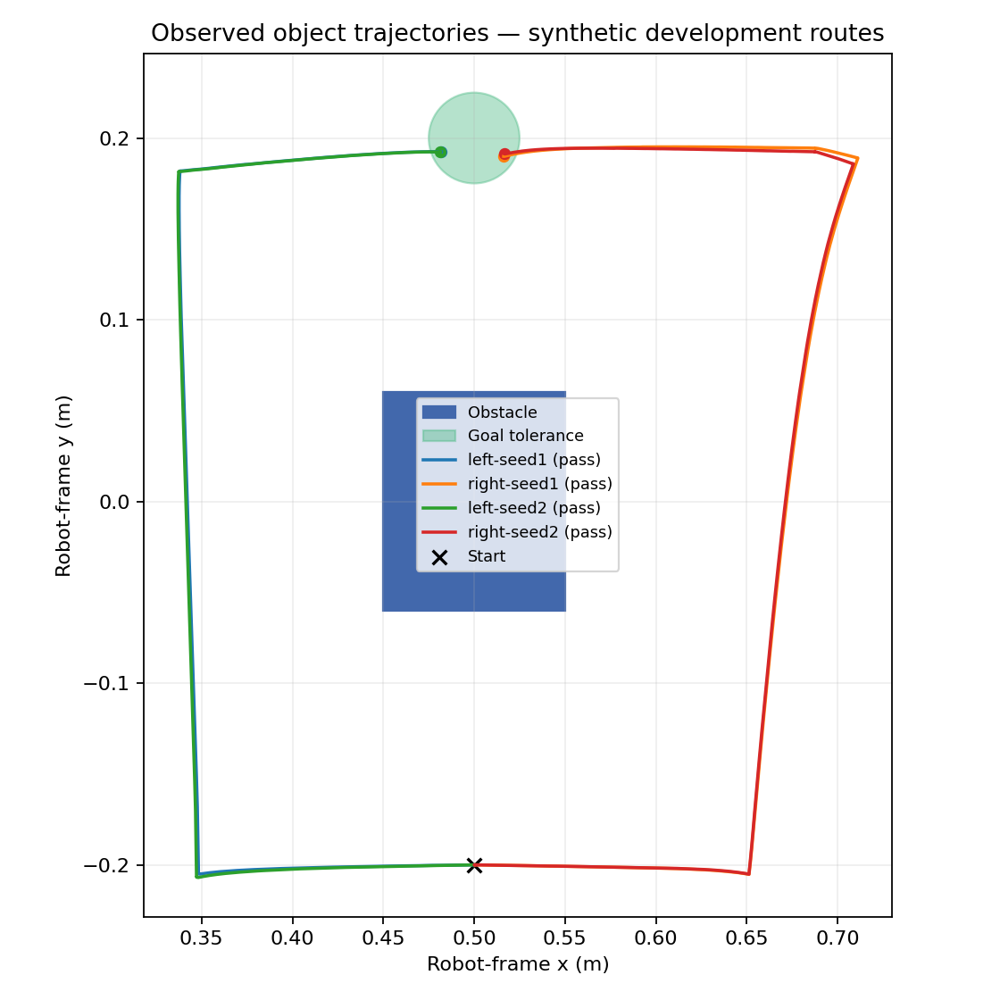

# Watch, Predict, Recover

A robot-learning research project for Humanoid's internship challenge: use personally recorded human object trajectories to guide a simulated Panda arm, then test whether learned dynamics improve execution and recovery.

**Current milestone (development, not frozen):** physical contact scoring, sampled layouts/friction/mass with disjoint splits, physical shoves and position interventions, a strengthened geometric controller, a learned dynamics ensemble and a learned-model planner. Paired dev results (600 identical scenarios per method; [table](experiments/dev-comparison-mpc.md)):

| Route success | Oct 8 controller | `RoutePusher` (strong baseline) | Learned-model planner |
|---|---|---|---|
| Nominal | 93.0% | 98.0% | 94.5% |
| Shove | 82.5% | 95.5% | 94.5% |
| Displace | 59.5% | 87.0% | 90.0% |

The learned model predicts cube motion far better than simple references (0.54 mm vs 10.6 mm median error at 1 s), but the untuned planner does not yet beat the strong geometric baseline (−0.5 points overall, p = 0.78). No test-split or human-data result exists yet.

## Environment

The recorded installation is Isaac Sim **5.1.0**, Isaac Lab **2.3.0**, Python **3.11.15**, and PyTorch **2.7.0+cu126**. Exact versions and prior smoke-test scope are in [isaac-installation.json](isaac-installation.json).

```bash
bash scripts/setup_isaac.sh
bash scripts/check_isaac.sh
```

The smoke test checks Franka simulation and camera rendering. Run the custom pushing scene and its unit tests with:

```bash
bash scripts/run_baseline.sh
bash scripts/test.sh -q
```

The baseline wrapper enables `--headless --video --wandb-mode online --entity mohamedsobhi777` and prevents concurrent launches through a GPU lock. Override tracking with `bash scripts/run_baseline.sh --wandb-mode offline` for local-only runs. Results are written under `artifacts/runs/<run-id>/`.

Development run `20261008T135756Z-a73b56` completed both routes under the current evaluator: left final error **19.50 mm**, right **19.12 mm**, with all three waypoints reached. Follow-up run `20261008T140024Z-c183ba` passed all four repeats, for six successful nominal episodes in total, with final errors of 18.94–20.00 mm. The layout is fixed across resets; this is a repeatability check, not a generalization score. Collision scoring currently checks cube–obstacle planar footprint overlap, not robot contact forces.



A separate two-episode diagnostic with a 2.5 cm position intervention failed on both routes (obstacle overlap on one, approach stall on the other). These failures are retained in the [experiment registry](experiments/registry.csv); recovery remains unfinished.

## First experiment

Move a 4 cm block from one side of an obstacle to the other, taking either of two specified routes. Keep start and goal identical while swapping the route. Later, replace those manually defined routes with trajectories extracted from phone recordings, then evaluate recovery from controlled disturbances.

The custom task is not an official LIBERO benchmark.

## Batched evaluation

Evaluation and model training (headless, no Isaac needed for training):

```bash
bash scripts/evaluate.sh --controller route --split dev --seeds 0 100 --disturbances none shove displace
.venv/bin/python scripts/train_dynamics.py --train-runs <train runs> --val-runs <val run>
.venv/bin/python scripts/eval_dynamics.py artifacts/models/<id> --runs <val run>
bash scripts/evaluate.sh --controller mpc --model artifacts/models/<id>/model.pt --split dev --seeds 0 100 --disturbances none shove displace
.venv/bin/python scripts/compare_runs.py artifacts/runs/<reference> artifacts/runs/<other>
```

W&B online access is verified for [mohamedsobhi777 / humanoid-watch-predict-recover](https://wandb.ai/mohamedsobhi777/humanoid-watch-predict-recover). The Python runner defaults to offline mode; the shell wrapper selects online mode. Local JSON/CSV remain available independently. The compatible tracker pin is `wandb==0.19.11` with Isaac's `click==8.1.7`.
