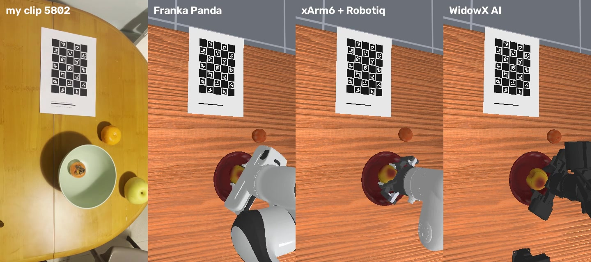
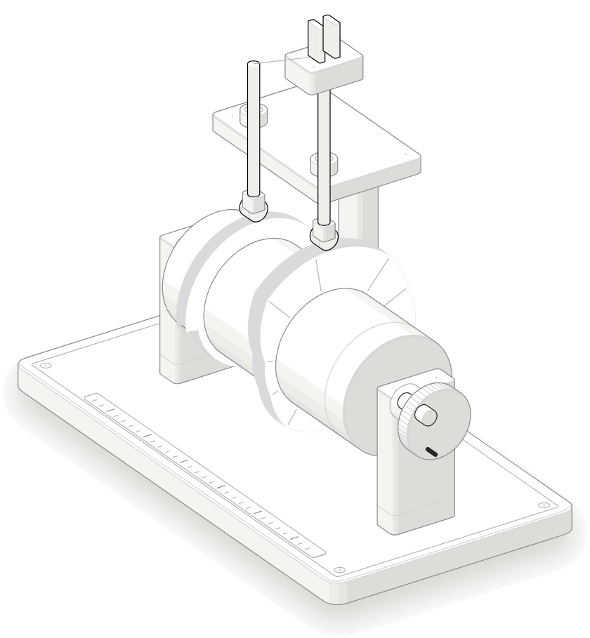
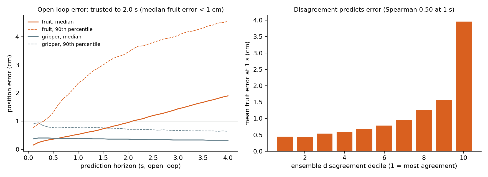

# Language-conditioned manipulation from egocentric human video

**My phone recordings supply the approach, grasp orientation, carry and release of a simulated robot—not just the name of the object to move.**

I recorded 30 clips of a persimmon, pear or mandarin being placed into a bowl. A calibrated hand-tracking pipeline extracts object-relative keyframes. A closed-loop controller executes those keyframes in new simulated layouts, producing demonstrations for a small target-conditioned image policy. The same keyframes also drive three different robot arms. An action-conditioned world model measures how far its predictions can be trusted.

[](docs/media/one-clip-three-robots.mp4)

[Watch the three-robot replay](docs/media/one-clip-three-robots.mp4) · [Watch the policy trained on my recordings](docs/media/own-data-policy.mp4) · [Slides: PDF](docs/presentation.pdf) / [PowerPoint with videos](docs/presentation.pptx) · [Reproduction guide](docs/reproduction.md)

## Results on my recordings

The policy is trained on **771 successful simulated demonstrations derived from 24 of my clips**, with six clips reserved for evaluation. Each table entry is 150 simulator episodes; the six held-out layouts are repeated with reset variation, not 150 independently recorded scenes.

| Demonstration source, same FiLM policy | New random layouts | My six held-out layouts | Crowded layouts |
|---|---:|---:|---:|
| Scripted expert, no human style | 90.0% | 84.0% | 85.3% |
| Public EgoDex video, 38 training clips | 97.3% | 96.0% | 86.7% |
| **My video, 24 training clips** | **96.0%** | **86.0%** | **88.0%** |

No wrong-fruit placement was observed in these nine evaluations. The human-data improvement on random layouts is concentrated in the non-round pear: **76%** with the scripted expert, **88%** with my styles, and **94%** with EgoDex styles. These are **single-training-seed, exploratory comparisons**, not proof of statistical significance or of my data outperforming EgoDex. The recordings and appearance calibration come from one shared session.

The preserved per-episode records are in [`results/`](results/); [evaluation details and limitations](docs/results.md) explain the protocols.

## How the video changes the robot

1. **Calibrate and identify.** A printed ChArUco board establishes a metric table frame. OWLv2 detects bowl/fruit regions; appearance prototypes assign the three fruit identities. My clips use manually supplied target labels, not speech recognition. A separate speech-based processing path is included.
2. **Track the hand.** WiLoR estimates the hand; projection against the calibrated camera places it in the table frame. The pinch trajectory and its proximity to fruit/bowl identify grasp and release.
3. **Keep decisions, replace timing.** Extract an approach offset, grasp yaw, lift/carry/release heights, release offset and retreat. Clamp them to the robot's feasible range. A state-machine controller uses simulator object poses to execute the style in new layouts.
4. **Learn from multiplied demonstrations.** Two ImageNet-initialized ResNet-18 encoders see an over-shoulder and wrist camera. The target fruit modulates every encoder stage with FiLM. A robot-state input and action-chunk head predict ten actions; five are executed before observing again. The policy does **not** receive object poses.



Language is deliberately narrow: a keyword/synonym parser maps instructions to one of three target identities. This is **not** an open-vocabulary or general-purpose VLA, and the object-aware demonstration generator is not itself the learned policy.

## Additional experiments

- **One clip, three arms.** Panda, xArm6 + Robotiq and WidowX AI each complete **30/30 recorded-style trials and 128/128 random-layout trials** under an embodiment-adapted keyframe controller. This is controller replay, **not zero-shot transfer of a learned policy**. Fourteen clips began with fruit already in the bowl; those replay trials use fresh layouts instead of their recorded initial layout. WidowX needs custom inverse kinematics and a reachable carry height.
- **Inference cost.** On an RTX 4090 Laptop, FiLM takes **1.84 ms per call in fp32**, or **0.69 ms with fp16, channels-last and compilation**. SmolVLA's base architecture takes **103.49 ms per call**: about 150× the call latency, or 75× amortized per executed action because the execution chunks differ. This is model-only timing on prepared inputs, not robot-loop speed; success tables use the fp32 policy.
- **World-model fidelity.** An ensemble trained on 6,144 perturbed rollouts of my training styles predicts outcomes on 2,048 held-out-style episodes with **89.4% accuracy**, versus **83.9%** for a plan-following reference. A separate 600-episode rolling-origin analysis keeps **median** fruit-position error below 1 cm through **2.0 seconds**. Full-episode median final-position error is **6.2 cm**; it is not a reliable long-horizon simulator replacement.



[Watch the world-model rollout comparison](docs/media/world-model-imagination.mp4).

## Baselines and unsuccessful directions

Development started on **public EgoDex clips before my recording session**. With 771 EgoDex-derived demonstrations and 30k training steps, the observed random-layout success rates are FiLM **97.3%**, ACT **13.3%**, Diffusion Policy **19.3%**, and SmolVLA **22.0%**. ACT/Diffusion receive target one-hot state, FiLM conditions its encoders, and SmolVLA receives text; this is not an architecture-only ablation or a claim about their general capabilities.

The SmolVLA run on **my own clips did not complete**, so no own-data VLA score is reported. Raw-path imitation, dexterous-hand grasping and long-horizon world-model policy ranking were also unsuccessful. RL fine-tuning was not performed. See [the full results discussion](docs/results.md).

## Run it

Tested on Ubuntu with an NVIDIA RTX 4090 Laptop (16 GB), Python 3.10, CUDA 12.4, ManiSkill 3.0.1, SAPIEN 3.0.3 and PyTorch 2.5.0. Vulkan rendering and the YCB assets are required.

```bash
python3.10 -m venv .venv-fruit
source .venv-fruit/bin/activate
python -m pip install --upgrade pip
python -m pip install torch==2.5.0 torchvision==0.20.0 --index-url https://download.pytorch.org/whl/cu124
python -m pip install -e .
python -m mani_skill.utils.download_asset ycb -y
python scripts/check_env.py artifacts/smoke
```

Download the trained policy from the [submission release](https://github.com/mohamedsobhi777/language-conditioned-manipulation-from-egocentric-human-video/releases/tag/submission-v1), then evaluate without needing the training videos:

```bash
mkdir -p data/fruitbowl
gh release download submission-v1 --repo mohamedsobhi777/language-conditioned-manipulation-from-egocentric-human-video \
  --pattern film_session2.pt --dir data/fruitbowl
python scripts/image_bc.py --film --load data/fruitbowl/film_session2.pt \
  --episodes 3 --seed 10000 --out artifacts/policy-smoke.json
```

For the 150-episode evaluations, demonstration generation, own-video processing and world-model training, use [`docs/reproduction.md`](docs/reproduction.md). Run commands from the repository root. Raw recording sessions and third-party model/dataset assets are not bundled; the release includes my processed hand plans and trained FiLM/world-model checkpoints.

## Read the code

| File | Purpose |
|---|---|
| [`fruitbowl/env.py`](fruitbowl/env.py) | Task, observations, layouts and physical success checks |
| [`fruitbowl/recording.py`](fruitbowl/recording.py), [`scripts/process_clips.py`](scripts/process_clips.py) | Phone video to calibrated hand/object plans |
| [`fruitbowl/expert.py`](fruitbowl/expert.py) | Human style extraction and closed-loop keyframe execution |
| [`scripts/make_expert_dataset.py`](scripts/make_expert_dataset.py) | Multiply styles into successful demonstration episodes |
| [`scripts/image_bc.py`](scripts/image_bc.py) | FiLM image policy training and closed-loop evaluation |
| [`fruitbowl/embodiments.py`](fruitbowl/embodiments.py) | Robot-specific command and inverse-kinematics adapters |
| [`fruitbowl/worldmodel.py`](fruitbowl/worldmodel.py) | Action-conditioned ensemble dynamics |
| [`results/`](results/), [`docs/results.md`](docs/results.md) | Recorded evidence, including negative results |

## Limitations

One person, one recording session, three scaled YCB stand-in fruit meshes, simulation only, privileged object poses during demonstration generation, shared session-level perception calibration, narrow target parsing, and no real-robot deployment. There is no independent end-to-end perception test, multi-task generalization result or safety guarantee. Older Isaac pushing work remains in Git history but is not part of this submission's results.

## References and attribution

- Perez et al., [FiLM: Visual Reasoning with a General Conditioning Layer](https://arxiv.org/abs/1709.07871).
- Jang et al., [BC-Z: Zero-Shot Task Generalization with Robotic Imitation Learning](https://arxiv.org/abs/2202.02005).
- [ManiSkill](https://github.com/haosulab/ManiSkill), [LeRobot / SmolVLA](https://github.com/huggingface/lerobot), [EgoDex](https://github.com/apple/ml-egodex), [WiLoR-mini](https://github.com/warmshao/WiLoR-mini), [OWLv2](https://huggingface.co/google/owlv2-base-patch16-ensemble), and [YCB](https://www.ycbbenchmarks.com/).

Third-party data, meshes, model weights and software retain their respective terms; they are downloaded separately rather than copied into this repository.
